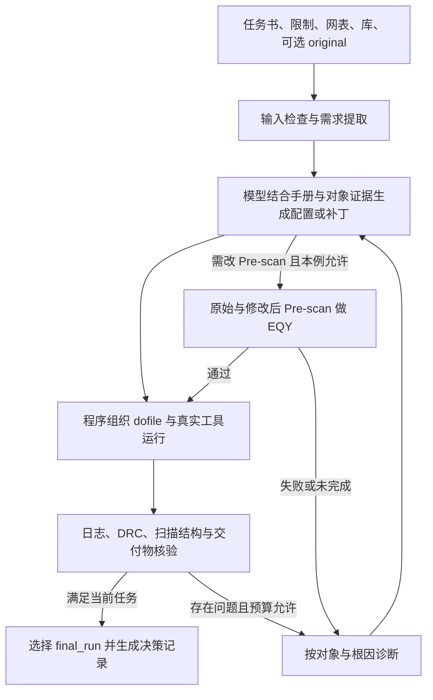

# Scan Insertion 智能体竞赛：冲冠实现方案与论文路线

编制日期：2026-09-07  
适用赛事：“长沙银行杯”2026 中国研究生创“芯”大赛 · EDA 精英挑战赛  
赛题：基于大语言模型的 Scan Insertion 智能体系统设计（广立微）

## 1. 建议采用的路线

建议实现一个**固定 DeepSeek V4 Pro 驱动、以官方工具反馈为依据的 DFT 专用智能体**：模型负责理解任务、选择需要查询的证据、定位根因和提出配置修改；程序负责文件与对象查询、命令组织、真实工具执行、结果核验和决策记录。

冲击第一名的重点，是在隐藏设计和未知故障组合上，同时做到：需求不漏、根因找准、修复有效、证据完整、尽量少跑工具。先把正确性与审计能力做扎实，再争取效率排名的前 30%。

本方案不建议一开始训练模型、搭多智能体讨论系统或开发自己的扫描链优化器。官方禁止调优指定模型；链构建已有专用工具；讨论式多智能体会增加延迟与 API 成本，目前没有证据表明值得付出这些代价。用一个主控智能体和几项边界清楚的程序功能即可起步。

“第一名”是研发目标，不能在没有隐藏用例成绩和竞争队伍数据时保证。本文给出的是按实际评分机制设计的争冠路线，不把公开用例跑通等同于夺冠。

## 2. 已阅读的官方资料与当前工作状态

三个 ZIP 已完整解压，原始文件保留在 `official/`。解压目录为 `official/extracted/`。

| 资料 | 本次阅读/检查范围 | 在方案中的作用 |
|---|---|---|
| 官方赛题 PDF，36 页 | 全文，尤其评分与附录 | 比赛边界、分值、输出与证据格式 |
| 线上宣讲 PPT，2026-08-27 | 全部幻灯片文字 | 任务定位、零分条件、同分规则 |
| `public_cases/` | 11 份任务书、限制文件、golden 命令流程、5 份预设问题清单；部分网表声明 | 场景覆盖、故障分类和实现风险 |
| `reference_submission/` | README、Python 主程序及目录结构 | 入口参考及基线缺陷分析 |
| `semitronix_EDA_docker/` | 环境说明、镜像归档结构 | 正式环境及工具位置 |
| 官方 Scan 用户手册，88 页 | 目录及相关信号、链、分区、DRC、导出章节 | 核对命令语义和诊断接口 |
| 6 篇论文的 arXiv 页面 | 标题、摘要与链接在线核验 | 选取可落地方法；不是全文复现实验 |

工具手册原先位于镜像内部，现已提取到：

`official/extracted/tool_docs/opt/dftexp_scan/doc/Scan_User_Manual.pdf`

当前环境是 Windows PowerShell；检测到 Podman 和 WSL 发行版，未检测到 `docker` 命令。本次没有导入/启动镜像、调用付费模型 API、验证 License，也没有实跑 Scan 或 EQY。因此下文的调用次数、时间分配和验收门槛均为建议目标，不能当作已取得的测试成绩。

## 3. 先把评分函数变成研发优先级

### 3.1 每个隐藏用例的得分

依据赛题指南第 11–18 页：

| 项目 | 任务一 | 任务二 | 研发含义 |
|---|---:|---:|---|
| 任务理解与配置正确性 | 60 | — | 每个独立错误扣 5 分，比较最终语义与报告 |
| 问题识别与根因定位 | — | 30 | 只复述错误不算定位；必须指出具体对象与原因 |
| 问题修复正确性 | — | 30 | 必须复跑证明消除，且不能引入新问题 |
| 可审计决策记录 | 20 | 20 | 真实引用、需求映射、修复 diff 和验证证据 |
| 效率 | 15 | 15 | 总时间、Scan 调用次数、模型用量各 5 分 |
| 输出完整性 | 5 | 5 | 文件、命名、目录与格式 |

效率三个指标分别按所有队伍排名：前 30% 得 5 分，30%–60% 得 2 分，后 40% 得 0 分。指南将模型用量项描述为以 API 平台计费金额表示；因此本地同时记录输入/输出 token 与可获得的费用数据，不能只比较输出 token。

总成绩为两个任务所有 hidden case 的分数之和。公开用例不计正式成绩，隐藏用例数量及两任务总权重目前未知。同分依次比较：任务二总分、核心正确性总分、任务二修复正确性、总时间、总 token。[S1，第 18–20 页]

由此得到三个决策：

1. 优先避免零分，其次拿稳正确性、审计和完整性合计的 85 分基础，再优化相对效率。85 分是分值构成，不是成绩预测。
2. 两个任务都必须完整覆盖；在共用能力之外，把更多诊断研发投入任务二，因为其同分优先且更能拉开差距。
3. 一个故障若同时漏诊、未修复，可能损失 10 分并影响审计分。为真实根因多花一次必要调用，往往比盲目追求最少轮数更划算。

### 3.2 必须落在执行器里的约束

- 正式运行只用指定的 DeepSeek V4 Pro，模型本身不得调优；接入参数从组委会注入的环境变量读取。
- 任务一不能修改输入 Pre-scan 网表；任务二仅在必要且当前 case 允许时修改工作副本。
- 任务二若修改 Pre-scan，须用 Yosys EQY 验证**原始 Pre-scan 与 final_run 实际采用的修改后 Pre-scan**。不是只证明最终 Post-scan 与原设计等价。
- 总 wall time 或 Scan 工具调用次数超过该 case 限制，记 0 分。
- 全自主，无运行中的人工确认。
- 不修改工具、Liberty、License 配置、评测脚本等受保护文件；不伪造或篡改日志与报告。
- 所有产物写入传入的输出目录，输入挂载只读。

当前 11 个 `limitations.md` 只列 wall time，未列调用次数上限。实现仍须能读取隐藏 case 给出的调用次数限制，不能把“公开文件没写”当作永远不限次数。

## 4. 公开用例告诉我们的真实能力边界

### 4.1 用例地图

下表简称用于讨论；程序不能按 case 编号选择固定答案。

| 用例 | 时限 | 核心场景 | 应验证的关键结果 |
|---|---:|---|---|
| T1/C1，openE902 | 150 s | ICG 重连、显式 DFF/SFF 映射、非扫描域回替 | 三阶段网表；特殊实例排除正确；不构建扫描链 |
| T1/C2，AC97 | 150 s | 7 个功能分区、双时钟域、分区使能 | 各分区链数与归属；默认分区覆盖顶层 FF；允许 DFTR10 残留 |
| T1/C3，E902 + AES | 150 s | Clock Mux、3 个黑盒实例、CTL、dedicated wrapper | 15 条 wrapper + 55 条非 wrapper 链；CTL 顶层实例路径；层级排除后局部恢复 |
| T1/C4，openE902 | 300 s | 从验收条件推导前置处理 | ICG 数量及 CLK/EN 不变；PLL 域全部回替；不新增 SI/SO |
| T1/C5，openC906 | 4800 s | 约 61.4 万时序单元、伪主输入、内部门控时钟 | 100% 目标覆盖、链长 ≤500、禁止跨时钟域、模式/复位配置正确 |
| T1/C6，DES | 300 s | 不可拆分长移位段、shared/dedicated wrapper 混用 | 链长 ≤100；保留既有 SE；key2 用指定单元、key1 不入扫描路径 |
| T2/C1，PicoRV32 | 150 s | 加载、映射、阶段顺序、时钟、ICG 使用范围、链数六类错误 | 每个根因分别定位并闭环；最终 4 条链 |
| T2/C2，Ethernet | 150 s | 非法参数/值、错时钟、复位极性、分区错绑 | WB/TX/RX 对应 34/1/1 条链；不能只看总链数 |
| T2/C3，TV80 | 150 s | 级联 ICG、latch 内部时钟、通道预算、多余 wrapper | 初始化周期足够、目标 FF 全覆盖、总链数及 SI/SO ≤5 对 |
| T2/C4，CV32E40P | 150 s | DRC 规则名/等级、复位与 SE、端口命名 | 链长 ≤100；只忽略指定 TIE 规则；不可改 Pre-scan |
| T2/C5，VeeR EH1 | 3600 s | 整段 DFT 配置和导出缺失、JTAG 排除 | TAP 不入链、链长 ≤1000、仅保留指定固有违例、交付物齐全 |

公开任务二共有 30 个预设问题，全部已阅读。这些问题提供很好的开发标签，但隐藏输入不包含 `golden.dofile` 和 `preset_issues.json`。[S1，第 31–34 页；S4]

### 4.2 已发现的具体陷阱

**设计简称不等于顶层模块。** T1/C6 的任务介绍是 `des_perf`，网表第 62413 行和 golden 的顶层为 `des3`；T2/C4 实际为 `cv32e40p_top`；T2/C5 为 `veer_wrapper`。任务给出的名字必须与实际 module 声明、层级和端口核对，不能从 `.v` 文件名直接推导 top。

**关闭电平不等于有效电平。** `-off_state` 表示关闭状态。Ethernet 的 `wb_rst_i` 经内部反相驱动低有效 FF 复位/置位引脚，其正确关闭电平为 0；CV32E40P 的 `rst_ni` 关闭电平为 1。不能只用 `_n`、`_b` 命名猜极性。

**链数配置优先于最大链长。** 手册明确冲突时优先 `chain_count`，实际链长可能超过 `max_length`。任务要求两者同时成立时，必须检查实际报告，不能看到两项参数都写了就通过。[S3，PDF 第 28 页]

**预处理任务本来就不插链。** T1/C1、C4 需要依次执行 ICG 重连、替换、回替并导出三个网表。不能套用完整 DRC→预生成→插链流程，更不能为凑输出生成虚假的 `post_scan.v`。

**Warning 也可能代表重大失分。** 例如 TV80 的链数超预算；DRC 默认等级本身也可能是 Warning。另一方面，T1/C3 明确允许因 CTL 扫描段不可拆分产生 SCAN-4902。判据必须来自当前任务，不能全局把 Warning 当成功或失败。

**参数有作用域和覆盖语义。** 分区配置依赖当前 partition；相同 usage 的 scan_enable 存在后设置覆盖规则；分区重复归属默认先定义者生效，`-force` 可改变归属。记录“最终生效配置”比搜索某条命令是否出现更重要。[S3，PDF 第 18、44–47 页]

**公开 golden 也是参考资料，需要核验。** T2/C2 任务书允许忽略两类 TIE，而 golden 只显式 Ignore TIE1，问题清单还允许 DFTR10 固有残留。输出命令也应逐项与任务书核对，例如 T1/C2 用 `rpt_insertion_info` 生成寄存器统计，不能仅因报告名称没有 `register` 就判断缺失。保留资料间的差异，不能把某例的允许项推广到全部隐藏设计。

### 4.3 官方参考程序不能直接作为得分基线

`reference_submission/submission/scan_agent.py` 中已确认：

| 问题 | 实际后果 | 实现时的处理 |
|---|---|---|
| 生成固定的空 `module top()` 作为最终网表 | 不是工具产生的设计结果 | 交付真实工具输出 |
| 最终报告写入 mock 内容，缺工具时模拟成功 | 与真实性规则冲突 | 失败如实记录，禁止模拟成功 |
| task 固定为 task1，需求映射与问题闭环为空 | 任务二及审计评分能力不足 | 按输入识别任务，从运行事实生成记录 |
| 实际主流程只有一次 Scan 调用 | 无自主修复闭环 | 增加有预算限制的诊断与复跑 |
| 固定 120 秒工具 timeout | 不适配 150/300/3600/4800 秒任务 | 统一管理整个 case 的剩余时间 |
| 依赖读取 golden 生成脚本 | 隐藏输入不提供 golden | 正式推理仅使用隐藏输入允许的资料 |
| prompt 将输入写为 `../../../input/...` | 从 `/output/runs/R1` 解析会得到 `/input`，但对指南中的其他挂载布局不通用 | 由入口参数生成明确的容器内路径 |

参考包保留原样；正式实现复用其入口约定和目录布局即可。不要通过把 mock 改成另一种占位内容来“修补”它。

## 5. 最小可行架构



初版建议 Python 3.12、指定模型的兼容 API 客户端、标准库 `subprocess/json/pathlib/difflib/time`。用普通主循环即可，不必引入工作流框架、数据库或向量服务。只有实测发现现有检索无法找回所需内容时，再考虑更复杂检索。

以下是建议的代码职责，不要求一项一个文件；初版可放在少量模块中。

| 职责 | 最少应实现的行为 | 对应的具体要求 |
|---|---|---|
| 输入与预算 | 解析入口、任务类型、文件清单、时限及轮数限制 | 无人值守和零分边界 |
| 需求理解 | 提取正向要求、禁止项、例外、输出清单及来源 | 配置正确性和 requirement_mapping |
| 手册与对象查询 | 精确检索命令/规则；查询真实端口与实例 | 未知故障定位与减少命令幻觉 |
| Dofile 生成/补丁 | 维护阶段、当前分区和对象引用 | 流程及配置语义正确 |
| Scan/EQY 执行 | 真日志、真实状态、超时控制、轮次保存 | 可审计运行与条件 LEC |
| 结果核验 | 检查要求是否在实际报告/网表成立 | 识别“运行成功但不满足规格” |
| 决策输出 | 引用、diff、最终轮次及产物复制 | 20 分审计与 5 分完整性 |

### 5.1 模型先产出需求与动作，不让它包办文件细节

每条内部需求保留四类信息：任务原句位置、对象与目标值、作用范围/例外、如何验收。它们直接服务评分，不另造庞大的规范语言。

例如 T2/C1：

```json
{
  "requirement": "共4条链，全部位于clk时钟域",
  "scope": "整个设计",
  "target": {"chain_count": 4, "clock": "clk"},
  "verify_with": "scan_chain报告中的实际链数和每条链的Clocks"
}
```

模型输入保留完整任务书；结构化提取帮助执行，但不能替代原文，以免“除了某实例”“仅替换”“允许残留”等条件在摘要时丢失。时钟、复位、SE、模式常量、分区、wrapper、segment、禁止修改和输出文件都要覆盖。

模型返回配置建议、定位对象、所依据的证据和下一步验证目标。路径、文件创建、轮次编号、diff、行号和最终复制由程序完成。内部字段不擅自塞入官方决策 JSON 的固定结构，最终按附录映射输出。

### 5.2 手册检索按命令和规则组织

将官方手册按章节/命令整理为本地可检索文本，保留 PDF 页码。评测时按当前需求与日志精确词查询，比如 `set_scan_signal`、`DFTR9`、`associated_internal_clocks`、`set_scan_segment`。首版用关键词与相邻段落检索即可。

每次送给模型的内容包括命令语法、选项作用域、默认/覆盖语义、限制和必要示例，不能只返回一条示例命令。语义相关但不在同一页的说明需要一起取回，例如链数与链长优先级。

手册有细节差异：PDF 第 69 页使用 `dump_def -section scan_chain`，公开 golden 使用 `dump_scan_def`；PDF 的分区说明中也有正文名字和示例名字不同的情况。开发时用镜像中工具的命令说明与小例实际执行确认支持接口，把确认结果用于正式生成，而不是实现多套自动猜测路径。

手册是参赛限定资料，知识内容用于队内研发和赛事允许的提交；不把手册原文公开上传论文仓库。

### 5.3 网表与库分析要围绕具体问题

openC906 网表约 271 MB，不适合整文件送入模型。首轮读取文件清单、模块声明、顶层端口、直接层级和所需单元类型；需要更深证据时，再查询对应对象及其局部驱动路径。

先用文本搜索定位候选位置，**不能把单行正则命中当作连接关系证明**。跨行实例、escaped identifier、数组与多层端口映射必须保留语义。优先用 Scan 工具已有报告和查询命令取得对象信息，只有缺少所需结构查询时才实现最小的门级连接读取功能。

具体需要回答的问题：

- 时钟/复位端口真实存在吗，实际 top 是哪一个？
- 错误实例使用哪个 Liberty 单元，其 clock/reset/scan 引脚及逻辑是什么？
- 复位从顶层到 FF 是否经过反相？
- ICG 的扫描控制端原来是常量还是功能信号，是否处于排除层级？
- 时钟路径是否经过 mux、latch 或多级 ICG？
- 长移位寄存器从哪个 SFF 开始，终点与既有 SE 连接是什么？

不得修改 Liberty 以配合错误映射。FF→SFF 映射需核对功能、边沿、复位/置位和扫描引脚；对任务允许的其他类型使用工具默认映射，不能无依据补齐所有可能单元。

## 6. 任务一：争取高一次通过率

### 6.1 两类流程，按任务选择

前置处理：

`load → present_design → 必要映射/ICG/非扫描域配置 → connect_icg_only → 导出 → replace_only → 导出 → replace_unscan → 导出`

完整插链：

`load_lib/load_netlist/必要CTL → present_design → 信号/分区/链/wrapper/segment配置 → examine_scan_drc → 报告 → examine_scan_chain → insert_dft_logic → 最终报告和网表/CTL/SCANDEF`

模板只固定已验证的阶段关系，具体配置来自当前需求与对象。不要按公开设计名直接替换整份 golden。

### 6.2 首跑前做便宜且必要的检查

- 输入文件与 top/端口/指定实例引用成立。
- 时钟与复位的信号类型、极性符合任务和连接证据。
- 当前 partition 切换正确，全局配置不会意外变成局部配置。
- SE 对 FF 与 ICG 的使用范围符合要求，wrapper 控制信号齐全。
- 先排除层级再恢复例外对象的顺序正确。
- 仅在任务允许时设置 DRC Ignore 或排除对象。
- 输出命令覆盖本例所需文件，不固定生成八份无意义报告。

可明确的命令名称、参数类型和路径检查交给程序；未知语义留给手册与工具，不写一个自创的完整 Tcl 解释器。

### 6.3 特殊场景的实现重点

**Black-box + CTL：**同时加载标准库与黑盒 Liberty，将 CTL 关联到正确 cell/module；检查每个实例的扫描段均进入顶层结构。T1/C3 golden 用总 chain_count 70 与 wrapper_count 15 实现目标，验收仍须实际得到 wrapper 15、非 wrapper 55，不只验证总数 70。

**长移位寄存器：**优先利用已有识别机制与报告；按任务需要把长段注册为不可拆分 segment，保存真实 SI/SO/SE 和时钟信息，保持既有扫描使能连接。T1/C6 的阈值是长度 ≥10，不能把所有相邻 FF 任意拼段。若同一次运行中动态查询所需信息的接口尚未证实，先验证接口再实现，不能为节省轮次凭空假设。

**超大设计：**流式处理日志与网表；避免把完整 stdout、报告明细和多份网表同时装入内存。模型只看统计及问题局部。硬件容量根据第一次大例的峰值内存实测决定。

## 7. 任务二：用少量复跑完成真实根因闭环

### 7.1 推荐执行策略

1. 保存输入 `original.dofile` 的原始内容。若需要迁移输入/输出路径，创建工作副本并明确记录路径改动，不修改输入文件。
2. R1 真实运行 original 的工作副本，保存完整日志和实际报告；同时核对其配置与任务要求。
3. 合并同根因的下游报错；查手册和对象证据，形成“对象—原因—修改—验证目标”。
4. 在一轮中合并修复已经有充分证据、彼此不冲突的问题；不为每个拼写错误单独跑一次工具。
5. R2 从干净工具进程重新执行完整流程。既检查错误和 DRC，也逐项检查链、分区、覆盖、wrapper 与输出。
6. 若上游错误解除后出现新证据，补充诊断后进入 R3；满足所有要求即停止。允许迭代次数受本例预算约束。

研发目标是常见配置故障 2–3 次 Scan 运行完成，并争取覆盖较多 2 次完成的情况。这不是硬性轮数上限，也不是已验证性能。

不要为了构造六个漂亮的 issue 人为制造错误，也不要为了凑“少轮数”写不存在的 R1 证据。原始脚本的上游错误可能遮住后续问题：只能引用实际已有的 dofile/网表证据；需要运行报告才能确认的问题应等到相应阶段暴露。静态发现的原始配置缺陷如何表达 `found.run_ref`，应在官方格式联调时确认，不能杜撰原本没有到达的工具输出。

### 7.2 故障定位顺序与修复粒度

| 故障族 | 首先看的证据 | 要找到的原因 | 有效修改与验证 |
|---|---|---|---|
| 加载/命令/顺序错误 | 第一处错误、对应 dofile、文件/对象清单 | 缺加载、错误参数、类型不匹配、阶段错序 | 修改具体语句；新日志证明该阶段实际完成 |
| 大片 FF 时钟不可控 | DRC 实例分布、clock 声明、共同上游 | 错主时钟、mode mux、ICG 未控制 | 修正控制配置；确认对应对象入链及违例消除 |
| 复位/置位不可控 | 端口到目标引脚的路径、Liberty 功能 | 关闭电平错误或控制缺失 | 改正确极性/信号；验证相关 DRC 与覆盖 |
| 级联 ICG 下游问题 | ICG 路径和深度、初始化配置 | DRC 初始化周期不足 | 按结构配置周期；TV80 三层案例要求 ≥2，不能把 2 当全局常量 |
| latch 传递时钟 | latch D/G/Q 路径、目标 FF | 内部时钟未关联或 clock latch 被误纳入 | 正确关联内部时钟；仅按任务排除该 latch；验证 FF 归属 |
| DRC 通过但规格错误 | 任务要求与实际 chain/partition/signal 报告 | 链数/长度/分区/端口/wrapper 不符 | 修正配置；逐项验证实际结构 |
| 必须改网表的结构问题 | 工具追踪路径、无法满足的控制结构 | 配置无法解决的结构根因 | 仅在允许时局部改工作网表，EQY 通过后完整复跑 |

`DFTR1` 只是“时钟不可控”的症状，不能见到它就一律增加时钟或 Ignore。一个错时钟引起上千个 FF 违例，往往是一个根因；不同端口极性错则可能是多个独立根因。无需建设通用知识图谱，先按具体驱动对象和因果关系归组。

手册提供 `examine_scan_drc_violation -violation_id ...`，可输出实例、引脚值和连接信息。[S3，PDF 第 57–58 页] 优先使用这种工具原生诊断，避免让模型对一屏错误编号猜结构。

### 7.3 修复的成功条件

修复成功必须同时满足：改对对象、修复根因、符合当前 case 的允许方式、真实复跑证明目标问题消除、没有引入新独立问题。

除任务明确允许外，降级 DRC、忽略规则、排除违例 FF、削减扫描覆盖率都不算解决问题。手册列出的“工具支持降级”并不代表比赛允许用它修复。

诊断记录应简短而可核验。例如：“R1 对 wb_clk 报端口不存在；顶层实际端口为 wb_clk_i，因此 WB 时钟域未声明。修改该端口引用后，R2 对应分区恢复实际链及 FF 覆盖。”比泛泛写“根据日志优化了扫描配置”更有评分价值。

## 8. 语义验收和审计是正式功能

### 8.1 不能只用退出码判成功

每轮至少区分三个状态：进程退出状态、工具流程是否到达要求终点、设计结果是否满足任务。工具可能在错误后继续执行，或生成了网表但结构不合要求。

完整插链按任务检查：

- 指定时钟、复位、SE、mode 常量及使用范围最终生效。
- 每个分区的链数、长度、时钟域、边沿、SE、SI/SO 名字符合要求。
- 目标可扫描单元无遗漏、无重复；允许排除的对象与任务一致。
- wrapper 的对象、策略、指定单元、控制信号和计数符合要求。
- segment 不被拆分，黑盒 CTL 实例路径存在，所需 SCANDEF/CTL 可读取。
- 所需 DRC 规则状态与残留违例集合符合当前 case。
- 任务要求的所有交付物真实生成。

覆盖率分母依据输入需求及工具可扫描性判定，不能先把漏扫对象标成不可扫描再宣称 100%。普通扫描单元、wrapper cell、不可展开黑盒段、多比特单元的计数口径要按对应报告区分，不直接用链长总和等同网表 FF 数。

前置处理则检查 ICG/FF 数量与指定连接、目标域回替、无新扫描链/数据端口，不能要求不存在的插链报告。

### 8.2 `decision_log.json` 按官方附录生成

任务一必需：`case_id`、`task`、`final_run`、`summary`、`requirement_mapping`、`issue_resolutions`、`tool_runs`、`file_changes`。一次通过时允许 `issue_resolutions: []`。

任务二的 `issue_resolutions` 必填且非空；每个问题包含 `found`、`diagnosis`、`attempts[].fix` 和 `attempts[].verify`。DFT 配置类问题填写 `diagnosis.violated_requirement`。网表修改记录中提供 `lec_ref`。[S1，第 21–31 页]

实现注意：

1. 模型负责简洁诊断解释；程序从真实文件计算行号、抽取原文，不让模型生成虚构 locator/excerpt。
2. `config_ref` 指向最终 dofile 的实际位置；修改后重新确定引用，不能沿用旧行号。
3. `artifact_ref`、`run_ref`、`lec_ref` 均指向存在的记录/文件。
4. `resolved=true` 必须有真实正向证据；例如实际报告中的零违例统计、目标链数和分区映射，不能自己添加一行“已通过”到工具报告。
5. 日志保存完整原文，允许另做内部解析；不得重写原日志。报告直接由工具生成，Agent 解释放在决策记录中。
6. `exit_status` 使用官方值 `completed/error/aborted`；超时中止如实记 aborted。
7. `final_results` 复制 `final_run` 所采用的脚本、日志与真实产物，按最终命名要求映射，内容保持一致。复制后不再让模型重写脚本或报告。

任务一需求映射有效覆盖率 ≥90% 才能拿满该子项 10 分；任务二正确闭环覆盖率 ≥90% 才能拿满该子项 15 分。研发目标应为 100% 关键项覆盖，给隐藏组合留下余量。

### 8.3 文件布局

```text
output/
  decision_log.json
  runs/
    R1/
      R1.log
      deliverables/R1.dofile
      deliverables/<本轮真实网表、CTL、SCANDEF等>
      reports/<本轮真实报告>
    R2/...
  final_results/
    final.log
    deliverables/final.dofile
    deliverables/<本例要求的最终交付物>
    reports/<本例要求的真实报告；需要时含LEC>
  diffs/
    dofile_R1_to_R2.diff
    <如改网表，按附录保留相对原始网表的diff>
```

报告文件名由当前任务书驱动，支持 `scan_cfg.rpt`、`veer_eh1_scan_cfg.rpt` 等具体名称。公共输出树是组织规则，不是要求所有任务都生成同一套报告。

## 9. LEC 能力必须提前建立

公开的 30 个任务二问题，其给出的标准修复均可在 dofile 层完成；这不意味着隐藏用例不会要求修改网表。该能力不能等决赛遇到时才临时写。

开发期先建立一个小而真实的验证链：加载原始与修改后的门级网表、相同单元功能模型、正确 top，用官方 EQY 流程证明等价。保留输入、配置、完整 EQY 输出和最终结论。然后用一处确实破坏功能的修改验证其会失败，防止验证配置漏掉目标逻辑。

需重点确认官方等价检查脚本如何定义功能模式，以及是否允许新增测试控制端口/模式约束。引入测试旁路可能只在功能模式约束下等价，不能自行固定任意信号来掩盖功能变化，也不能仅把单元全部 blackbox 后宣称证明通过。

最终采用的 Pre-scan 若已修改，LEC 失败、超时或未完成都不能作为成功方案交付。即使多个中间版本各自相邻等价，也必须满足官方“原始到最终采用版本”的检查要求。

## 10. 时间与调用预算设计

用单调时钟维护整个 case 的截止时间；每次模型/Scan/EQY 调用前计算剩余预算，为报告处理、产物复制及退出留时间。不能只给单次 `subprocess` 一个固定 timeout。

150 秒用例的一个初始分配示意：

| 阶段 | 初始预留 | 实施说明 |
|---|---:|---|
| 输入解析、检索与首轮模型决策 | 25 s | API 延迟必须实测 |
| R1 执行与结果解析 | 40 s | 避免重复加载和无关报告 |
| 定位、补丁生成 | 20 s | 把已确认问题合并处理 |
| R2 完整验证 | 45 s | 以第一轮耗时评估是否充足 |
| 最终复制、引用检查、退出余量 | 20 s | 最后仍受 150 s 总时限约束 |

这只是初始工程预算，不是各阶段保证耗时；测得真实分布后调整。如果工具一次就接近限时，优先提高首轮决策质量并减少非必要工作，不能机械要求再跑一轮。

记录开发指标：端到端时间、每阶段时间、Scan 进程调用次数、API 实际 usage、峰值内存、最终问题残留。Scan 调用次数的统计口径以主办方为准；不能通过在同一进程里重复完整流程来规避轮数统计。

优先优化顺序：正确性稳定后，减少无用工具重跑 → 减少传给模型的无关内容 → 合并确定性修改 → 减少重复文件处理。不要仅为省 token 丢掉任务中的禁止项、例外和完整输出要求。

## 11. 验证方案：证明对未知设计有用

### 11.1 三类开发评测

**公开功能回归。** 11 个 case 按本例任务书验收。模型运行时不读取 golden/preset；这些文件仅由开发期评测读取，用于检查需求和根因是否覆盖。

**按设计族留出。** T1/C1 与 C4 都是 E902，T1/C3 也含 E902，不能把它们当完全独立的训练/测试样本。把共享核心和结构的用例作为同一族进行留出，评估系统能否在没见过该设计的情况下工作。

**受控故障变体。** 在独立测试副本中注入任务已涉及的故障：错参数/取值、加载缺失、错序、极性、SE usage、分区绑定、链预算、wrapper 多余配置、报告缺失；再组合互相遮蔽的故障。变体要求可核验的正确答案，不能任意变更后假定任务仍可满足。

可加入一致重命名与规格数值变更，但必须同步维护相关引用、确认变更后的设计/任务可行，并留出未参与调参的组合。公开原件不改，最终提交不包含预生成的答案或按文件特征识别 case 的逻辑。

### 11.2 需要关注的指标

| 指标 | 目标 | 为什么必要 |
|---|---|---|
| 有效性/合规失败 | 0 | 防止整例零分 |
| 关键需求满足率 | 100% | 避免配置独立错误 |
| 公开任务二根因定位 | 30/30 正确；同时统计误报 | 只看召回会鼓励乱报问题 |
| 问题真实闭环率 | 100% | 修好但说不清会丢审计分 |
| 输出及引用闭合 | 100% | 由程序可直接核验 |
| T1 一次通过率 | 持续提高，按设计族报告 | 减少时间、成本和工具调用 |
| T2 完成轮数 | 常见例争取 2–3 轮 | 仅在正确性不降时优化 |
| 独立留出变体通过率 | 初步门槛 ≥95% | 内部研发门槛，不代表 hidden 得分 |

一次公开用例通过只证明这次运行；对高风险改动做相关回归，对最终候选进行一次完整回归及独立留出评测。不要每改一行都跑全部大例。

### 11.3 消融实验要回答具体问题

从“真实执行的简单直接生成/修复”开始，不拿官方 mock 输出作性能基线。依次比较：

1. 加入按命令/规则的手册检索，是否减少语法与语义错误？
2. 加入显式需求覆盖和实际结果验收，是否发现无 DRC 错误的配置问题？
3. 加入对象/上游根因归组和批量补丁，是否减少轮数及误修？
4. 加入局部结构查询，是否解决 clock mux/latch/ICG 等隐藏结构？
5. 在同等正确率下压缩上下文，是否降低费用和端到端时间？

每次记录同一批 case 的正确性、闭环、时间和用量；没有收益就撤掉新增机制。论文里的更高 benchmark 分数不能代替本赛题实测。

## 12. 实施排期与分工

目前未知队伍人数和截止日期，以下按 3 人、4 周给出起始排期。人少可合并职责，时间紧优先保留 P0，而不是删掉真实验证。

| 阶段 | 交付 | 完成标准 |
|---|---|---|
| 第 1–2 天：环境与规则 | 官方镜像可运行，License/模型连通，小例真实日志，输出约定明确 | 不再有 mock；入口能无人值守启动 |
| 第 3–7 天：最小闭环 | T1 前置处理/普通扫描；T2 PicoRV32；真实决策记录 | 能发现问题、补丁、复跑、定位引用 |
| 第 2 周：场景覆盖 | 多分区、复位/门控、CTL、wrapper、segment | 11 个公开例逐项覆盖；同时验证 EQY 小例 |
| 第 3 周：泛化与大例 | 设计族留出、故障组合、C906/VeeR 内存和耗时 | 解决尚未覆盖根因，验证预算控制 |
| 第 4 周：效率与冻结 | 消融、上下文压缩、干净构建与正式格式联调 | 完整回归通过，留出结果记录，提交包自包含 |

建议分工：

- DFT 负责人：工具语义、clock/reset/ICG/wrapper/segment、网表局部诊断与 EQY。
- Agent 负责人：任务理解、手册检索、补丁决策、预算控制与模型调用。
- 验证/交付负责人：语义验收、公开及留出评测、证据输出、镜像与打包。

P0：真执行、两个任务、完整需求与证据、零分边界、11 例场景。P1：隐藏变体、网表改动与 EQY、难例性能。P2：在上述指标稳定后继续压缩费用与延迟。网页演示、自动生成长篇说明和多智能体辩论暂不投入。

硬件先使用 Linux 容器运行官方镜像，建议准备 SSD 和可扩展内存；C906 规模较大，可将 64 GB 主机作为采购/借用的初始考虑，但目前没有实测内存数据，不能认为其为官方最低要求。模型走 API，当前路线不需要本地训练 GPU。

若只能投入一周：先完成官方环境、小例真实执行、T2 六类常见错误闭环、需求/产物核验，再扩展难场景。应明确这会降低对复杂 hidden case 的竞争力，不能称为完整争冠版本。

## 13. 参考论文与阅读安排

以下 6 个 arXiv 链接已于 2026-09-07 成功访问并核对标题/摘要。本文选取方法思路，不把论文中其他模型、其他任务的实验增益套用为本赛题收益。

| 优先级 | 文献 | 值得借鉴的部分 | 本赛题中怎么用、哪里不能照搬 |
|---|---|---|---|
| P0 | **ChatEDA: A Large Language Model Powered Autonomous Agent for EDA**，2023，[arXiv:2308.10204](https://arxiv.org/abs/2308.10204) | 任务分解、脚本生成、EDA 工具执行 | 作为整体闭环架构参考；其 AutoMage 微调路线不适用本赛题 |
| P0 | **AutoChip: Automating HDL Generation Using LLM Feedback**，2023，[arXiv:2311.04887](https://arxiv.org/abs/2311.04887) | 根据编译/仿真反馈修正生成内容 | 将反馈源换成 Scan 日志、DRC 和结构报告；不能只关注语法/运行成功 |
| P0 | **ReAct: Synergizing Reasoning and Acting in Language Models**，2022，[arXiv:2210.03629](https://arxiv.org/abs/2210.03629) | 推理决策与外部工具观察交替 | 用来安排“下一步查询什么、改哪里、怎么验证”；决策日志保留简洁证据解释即可 |
| P1 | **ChipNeMo: Domain-Adapted LLMs for Chip Design**，2023，[arXiv:2311.00176](https://arxiv.org/abs/2311.00176) | 芯片领域知识、检索及 EDA 脚本/问题分析 | 借鉴领域语料组织和检索；继续预训练、模型对齐及额外模型能力不能直接用于指定模型限制下的参赛系统 |
| P1 | **Reflexion: Language Agents with Verbal Reinforcement Learning**，2023，[arXiv:2303.11366](https://arxiv.org/abs/2303.11366) | 从失败反馈总结并改变下一次行动 | 仅保留本 case 已证实的失败原因，避免同一错误重复尝试；没有需求时不做跨 case 永久记忆系统 |
| P2 | **LLM4EDA: Emerging Progress in Large Language Models for Electronic Design Automation**，2024，[arXiv:2401.12224](https://arxiv.org/abs/2401.12224) | 领域综述、应用分类及研究背景 | 用于报告/答辩定位，不当作具体 Scan 工具手册 |

DFT 基础和验证资料同样重要：

- **Wang, Wu, Wen，VLSI Test Principles and Architectures: Design for Testability，2006。** 官方指南推荐。优先阅读 DFT、扫描设计和 core-based testing，弄清 shift/capture、可控性、可观测性与 wrapper。
- **Bushnell, Agrawal，Essentials of Electronic Testing for Digital, Memory and Mixed-Signal VLSI Circuits，2000。** 官方宣讲推荐。用于补齐数字测试、扫描和边界扫描基础。
- **[YosysHQ EQY 官方文档](https://yosyshq.readthedocs.io/projects/eqy/en/latest/)**，已核对网站可访问。实现时重点研究配置、单元模型、匹配/分区、证明状态及失败诊断。
- **本地 Scan 引擎用户手册。** 编程时优先级最高，尤其 PDF 第 16–29 页（信号/段/链）、第 32–47 页（ICG/wrapper/partition）、第 53–69 页（DRC/验证/导出）。正文印刷页码比这里的 PDF 页序少 5 页。

推荐阅读顺序：工具手册及 PicoRV32 任务 → Scan 基础 → ChatEDA/AutoChip → ReAct → 实现闭环 → ChipNeMo/Reflexion 中有需要的部分。不要先花一周泛读综述再开始跑工具。

## 14. 开工前需要确认，但不阻碍主体研发的事项

| 尚未明确的项目 | 当前证据 | 对实现的影响 |
|---|---|---|
| 截止日期、队员人数、可用主机/API 预算 | 本次未提供 | 调整排期和实验规模 |
| 最终上传程序 ZIP 还是参赛镜像 | PDF 强调自包含包，PPT 描述镜像，参考 README 给 ZIP | 先保持官方基础镜像与标准入口，最后按平台当前说明打包 |
| 隐藏 case 的调用次数上限和计数口径 | 指南有限制，公开 limitations 未列 | 预算控制支持可选上限；不做绕计数设计 |
| 评测 CPU、内存与 API 延迟 | 环境文档未给硬件配额 | 大例时间/内存须在接近正式环境下测量 |
| EQY 官方脚本、模式约束和接口 | 镜像说明有 EQY，目录中未见独立评测脚本 | 决定哪些网表变更可被正式证明接受 |
| 官方 Q&A 与更新公告 | PDF 提及，当前目录未发现该文件 | 尤其核实输出差异、静态证据表达及版本行为 |

这些事项作为开工检查清单；本次未向组委会发送消息。现有资料已经足够启动环境、小例、语义验收与诊断闭环的实现。

## 15. 第一轮开发的明确交付

第一轮以 T1/C4 和 T2/C1 为落点：前者证明不会把“仅前置处理”误做成插链，后者同时覆盖加载、映射、错序、时钟、ICG 和链数修复。完成后交付：

1. 官方容器中可执行的 `/submission/agent_system -input ... -output ...`。
2. 两个用例的真实工具日志、完整产物和可核验 decision log。
3. 任务二各根因的发现、补丁和复跑证据。
4. 一份按任务项列出的实际验收结果，以及时间、Scan 调用次数和模型用量。
5. 对尚未覆盖的分区、wrapper、CTL、segment、大设计和 EQY 能力给出明确待办。

后续争冠工作的验收标准是独立设计族和未知组合上的成功率，而不只是公开题答案匹配率。

## 来源索引

- **[S1]** [官方赛题指南 PDF](official/赛题二：基于大语言模型的Scan%20Insertion智能体系统设计（广立微）.pdf)：第 3–8 页任务及模型限制；第 9–20 页评分与零分条件；第 21–36 页日志与目录格式。
- **[S2]** [官方线上宣讲 PPT](official/EDA精英挑战赛_Scan_Insertion_赛题线上宣讲.pptx)：第 6–15 页任务、评测与提交；第 16 页学习资料。
- **[S3]** [Scan 引擎用户手册](official/extracted/tool_docs/opt/dftexp_scan/doc/Scan_User_Manual.pdf)：2026-07-06 版，从官方镜像层提取。
- **[S4]** [公开用例目录](official/extracted/public_cases/)：各用例 `input/task_spec.md`、`limitations.md`、`golden.dofile`，任务二 `preset_issues.json` 和 `original.dofile`。
- **[S5]** [参考程序](official/extracted/reference_submission/submission/scan_agent.py) 与 [参考说明](official/extracted/reference_submission/README.md)。
- **[S6]** [官方环境说明](official/extracted/semitronix_EDA_docker/environment.md) 与 [Docker 工作流说明](official/extracted/semitronix_EDA_docker/README.md)。

本文为基于资料检查的研发方案，不包含实跑成绩；官方后续公告、平台规则和经确认的工具版本行为需要在实现阶段同步核对。

## 补充：2026-09-07 平台实查

使用用户提供的本地账号已成功登录评测平台，并找到[赛题页面](http://competition.nctieda.com:30080/competitions/38/)。凭据不写入本方案。本次仅登录和读取页面/API 信息，未报名、上传或触发评测。

- 平台明确：打榜练习阶段的阿里云百炼 API Key 由参赛者自行提供。当前 `accounts.txt` 仅提供平台网址、使用指南和登录凭据，未提供模型 API Key，因此尚不能进行指定模型的真实调用。
- 当前“打榜评测阶段”配置为 2026-08-17 至 2026-11-20；结束时间为北京时间 2026-11-20 17:00。此为平台当前阶段结束时间，不等同于已确认的赛事最终提交截止日。
- 提交条款要求包含 Dockerfile、代码及 `.env`，文件不超过 100 MB；页面指向资源下载中的提交示例。研发产物继续按程序 ZIP 的组织方式准备。
- 页面存在未同步内容：概述仍写 6 个公开案例，而数据说明写 11 个；任务分类描述也与正式赛题指南不一致。任务定义继续依据正式 PDF 和具体 case 任务书。
- 提交次数存在冲突：条款写每天 5 次，当前 phase API 配置为每天 50 次、每人总计 100 次。正式提交前应核对登录后的实际限制，不能依较宽上限推断授权或可用次数。
- phase API 的 `execution_time_limit` 为 2000 秒，与本地部分 case 的 3600/4800 秒不一致；尚未确认平台外层运行限制与 case 内层限制如何协调，需在联调时查清。
- 平台输入数据条目的更新时间为 2026-09-07。本次没有重新下载该数据或确认其与本地 ZIP 内容一致。

本机 Podman 虚拟机已运行，配置为 8 CPU / 8 GiB 内存；官方 Scan 基础镜像尚未导入。现有内存能否承载大例须实测，不能据此宣称环境已就绪。

## 补充：Luna 本地开发测试

用户已指定暂时复用当前 Codex API，使用 Luna 做本地测试。已从 Codex 当前 provider 配置读取接口地址，并通过其指定的环境变量读取密钥；不复制密钥到代码、报告或提交包。按 [OpenAI 配置文档](https://developers.openai.com/codex/config-reference/)核对 provider 和 Responses 协议；具体 Luna 可用性由实际代理响应确认。

- 测试脚本：`dev/test_luna.py`；在现有 Windows 环境运行 `python .\dev\test_luna.py`。
- 请求及返回模型均为 `gpt-5.6-luna`，使用 Responses 流式接口，推理强度 low。
- 测试任务为 T1/C4 需求提取，未读取 golden，也未执行 Scan 工具。
- 共进行了 3 次 API 请求。首轮发现测试脚本未明确层级字段应为数组；第二轮发现“所需网表”字段被理解为输入文件。修正字段类型与输出语义后，最后一轮 7 项关键字段检查全部通过。
- 最后一轮耗时 13.86 秒，输入 791、输出 504，共 1295 token；三轮 API 返回总用量合计 3779 token。这是单例接口及需求提取测试，不是端到端时限或泛化能力证明。
- 最新结果：`dev/results/luna_task1_case4.json`。正式参赛实现仍按赛题要求切换到指定 DeepSeek V4 Pro；Luna 测试产物未上传平台。

## 实施更新：2026-09-22 至 09-23

第一阶段代码已落地，详见 [README](README.md) 和 [本轮开发记录](dev/开发进展_20260922.md)。官方镜像与 License 已实测可用，Luna 已与真实 Scan 工具串联。

- T1/C4 最新端到端运行 31.24 秒，三个阶段网表真实生成，六项独立结构检查通过；完整可扫描性验收仍未完成。
- T2/C1 在 79.11 秒内通过两轮 Scan 完成六个根因的配置修复，实际生成 4 条链、1610 个唯一扫描 FF，DRC 0；证据引用、diff 与最终文件副本通过独立检查。
- 开发中的失败记录全部保留。尚未实现完整隐藏场景能力、正式模型接入和 EQY，不把本阶段结果视为完整竞赛验收。
